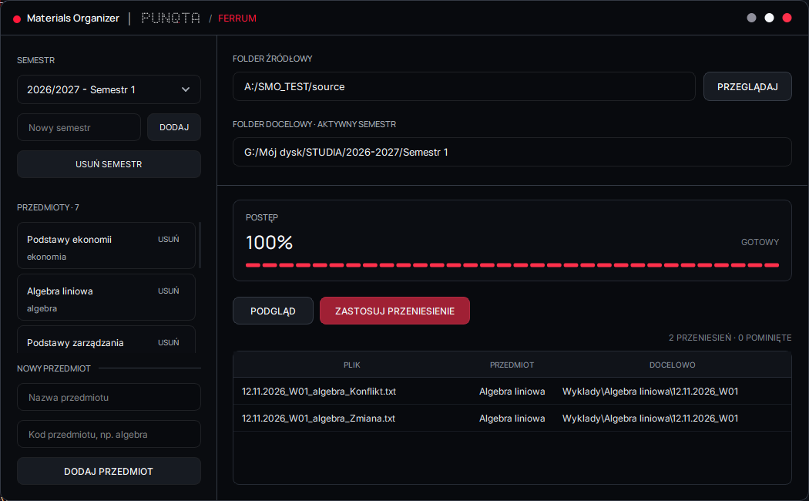

<div align="center">
  

  <h1>Materials Organizer</h1>

  <p>A minimal desktop application for organizing university study materials.</p>

  <p><strong>Python · PySide6 · PUNQTA / FERRUM</strong></p>

  <p>
    <a href="https://github.com/Svazsty/study-materials-organizer/releases/download/v0.2.0/MaterialsOrganizer-v0.2.0-Windows-x64.zip">Download for Windows</a>
    &nbsp; · &nbsp;
    <a href="https://github.com/Svazsty/study-materials-organizer/releases/download/v0.2.0/MaterialsOrganizer-v0.2.0-Fedora-x64.zip">Download for Fedora</a>
  </p>
</div>

---



## Features

- **Automatic organization** — sort study materials by subject, date, lecture or exercise.
- **Preview before moving** — review destination paths before confirming.
- **Semester & subject management** — customize your courses and folders.
- **Safe file operations** — conflict detection, file validation and background processing.
- **Minimal interface** — lightweight desktop GUI with the PUNQTA / FERRUM visual identity.

## Installation

**Windows**

Download the Portable ZIP, extract it and launch `MaterialsOrganizer.exe`.

**Fedora Linux**

Download the Fedora ZIP, extract the included RPM package and install it using:

```bash
sudo dnf install ./materials-organizer-*.rpm
```

No separate Python installation is required.

## Filename format

Materials are classified using their filenames.

```text
DD.MM.YYYY_W01_subject_description.pdf
DD.MM.YYYY_C01_G1_subject_description.pdf
```

For example:

```text
12.11.2026_W01_algebra_notes.pdf
12.11.2026_C01_G1_algebra_exercises.pdf
```

`W` indicates a lecture, `C` an exercise, and `G1` the exercise group.

## Run from source

Requires Python 3.13+ and [uv](https://docs.astral.sh/uv/).

```bash
git clone https://github.com/Svazsty/study-materials-organizer.git
cd study-materials-organizer
uv sync
uv run python app.py
```

## Notes

The organizer moves files, rather than permanently duplicating them. Use the preview to verify destinations and keep backups of important materials.

Only supported filename patterns are processed.

## License

Source code: [MIT License](LICENSE).

PUNQTA / FERRUM branding and bundled font assets are subject to their respective usage permissions.